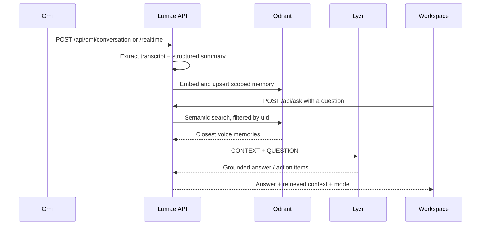

# Lumae

> **Voice memory, made legible.**

Lumae is a privacy-first voice memory command center for the **Privacy-first Knowledge Systems** track of the Stop Prompting, Solo Agents Hackathon. It turns ambient Omi conversations into scoped, searchable memories, retrieves the closest context from Qdrant, and passes only that context to a Lyzr reasoning agent.

## Why it exists

People say important things in the gaps between meetings and then lose them. Lumae keeps the human voice as the interface while making the resulting signal searchable, explainable, and private by default.

## The connected loop



## Stack

- **Omi** — real-time voice capture and ambient input through two webhook endpoints.
- **Qdrant** — persistent vector memory with a 384-dimension deterministic embedding and per-user `uid` filter.
- **Lyzr** — manager/agent reasoning over the retrieved context when credentials are connected.
- **Vercel** — static frontend plus serverless API functions.

## Run locally

```bash
cp .env.example .env
npm start
# open http://localhost:3000
```

The interface is runnable in demo mode without credentials. It still demonstrates the full product loop, with safe local fallback memories and a clearly labelled demo response.

## Connect the live services

Set these values in Vercel Project Settings → Environment Variables, or in `.env` for local development:

```bash
LYZR_API_KEY=...
LYZR_AGENT_ID=...
QDRANT_URL=https://your-cluster.qdrant.io
QDRANT_API_KEY=...
QDRANT_COLLECTION=lumae_voice_memory
```

The first live write creates the collection with cosine distance and 384 dimensions. No API key is committed to this repository.

### Omi webhook URLs

After deployment, point Omi Developer Mode at:

- Memory creation: `https://YOUR_DOMAIN/api/omi/conversation?uid=YOUR_OMI_UID`
- Real-time transcript: `https://YOUR_DOMAIN/api/omi/realtime?uid=YOUR_OMI_UID`

Both endpoints return quickly and defensively handle Omi transcript payload variants.

## API surface

| Method | Route | Purpose |
|---|---|---|
| GET | `/api/health` | Safe readiness summary; never returns secrets |
| POST | `/api/omi/conversation` | Index a finished Omi conversation |
| POST | `/api/omi/realtime` | Index incremental real-time transcript segments |
| POST | `/api/ask` | Retrieve scoped memories and ask the Lyzr agent |

Example:

```bash
curl -X POST https://YOUR_DOMAIN/api/ask \
  -H 'Content-Type: application/json' \
  -d '{"uid":"YOUR_OMI_UID","question":"What are my open action items?"}'
```

## Privacy boundary

Every Qdrant payload stores the `uid` supplied by Omi. Every retrieval applies the same `uid` filter. Lyzr receives only the retrieved snippets plus the current question, never the whole collection. The UI includes a visible workspace boundary and a demo-memory reset action.

## Project structure

```text
index.html                 Product shell and accessible interface
styles.css                 Dark editorial visual system and responsive layout
app.js                     Frontend interactions and demo mode
server.mjs                 Dependency-free local server with API fallback
api/_lib/memory.mjs        Embedding, Qdrant retrieval, and Lyzr orchestration
api/ask.mjs                Grounded query endpoint
api/omi/*.mjs              Omi webhook endpoints
api/health.mjs             Safe readiness endpoint
public/manus-routes.json   Route manifest
```

## Hackathon submission details

- **Project name:** Lumae
- **Build track:** Privacy-first Knowledge Systems
- **Omi usage:** Ambient capture via conversation and real-time transcript webhooks.
- **Qdrant usage:** Scoped vector upserts and semantic retrieval filtered by workspace uid.
- **Lyzr usage:** Context-grounded answers and action-item reasoning.
- **Demo mode:** Keeps the deployed experience watchable before private keys are configured.
